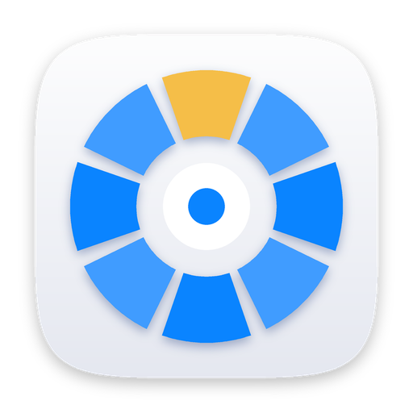
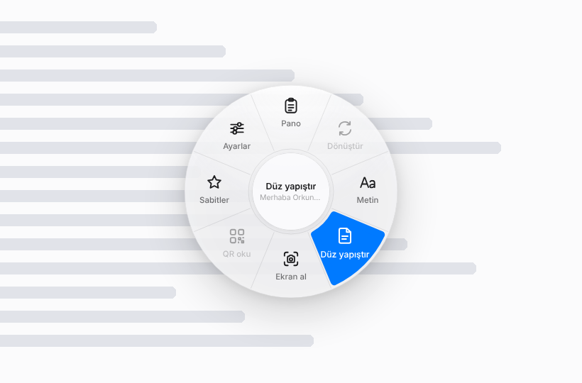
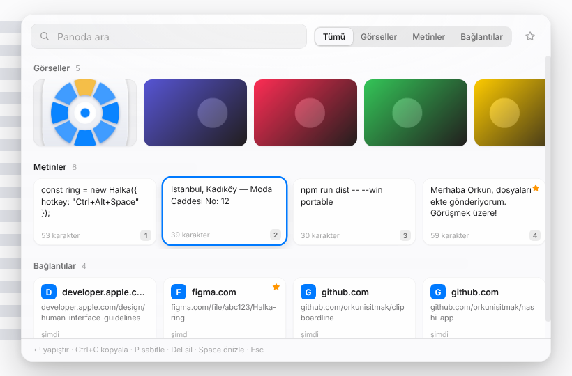
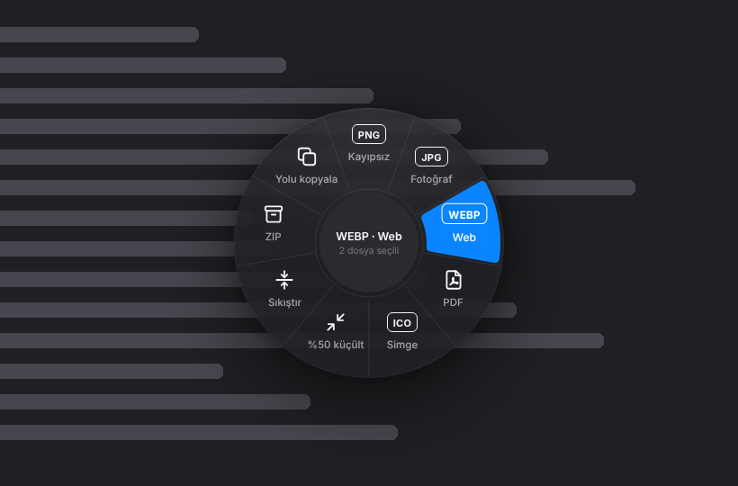

<p align="center"></p>
<h1 align="center">Halka</h1>
<p align="center">İmlecinin etrafında açılan, macOS görünümlü tek bir menü. · A macOS-style ring menu around your cursor, for Windows.</p>

Halka, [Nashi](https://github.com/orkunisitmak/nashi-app)'nin dönüştürme çarkını ve [ClipBoardLine](https://github.com/orkunisitmak/clipboardline)'ın pano raflarını tek bir kısayolda birleştirir. **Ctrl + Alt + Space**'e bas, menü imlecin olduğu yerde açılır; bir dilime bak, tıkla ya da tuşu bırak.

| Halka | Pano rafları | Dönüştür |
| :---: | :---: | :---: |
|  |  |  |

## Ne yapar?

| Dilim | Ne yapar |
| --- | --- |
| **Pano** | Kopyaladığın görseller, metinler ve bağlantılar üç rafta. Ok tuşlarıyla gez, **Enter** önceki uygulamaya yapıştırır, **Shift+Enter** biçimsiz yapıştırır. **P** sabitler, **Del** siler, **Space** önizler, yazmaya başlayınca arar. |
| **Dönüştür** | Explorer'da (veya masaüstünde) seçili dosyalar için: PNG, JPG, WEBP, PDF (görsellerden tek PDF), ICO (16–256 px), %50 küçült, sıkıştır, ZIP, yolu kopyala. Çıktılar kaynağın yanına, üzerine yazmadan kaydedilir. |
| **Metin** | Seçili metni (yoksa panodakini) BÜYÜK / küçük / Başlık yapar, boşlukları temizler, JSON'u düzenler, slug'a çevirir, Base64 kodlar/çözer veya sayar — ve yerine yapıştırır. Türkçe İ/ı kurallarına uyar. |
| **Çevir** | Seçili metni (yoksa panodakini), panodaki/Explorer'da seçili görseli veya ekrandan seçtiğin bir alanı çevirir. Sonuç imlecin yanında bir kartta açılır: **Enter** yerine yazar/yapıştırır, **Ctrl+C** kopyalar, dil menüsünden hedef dil değişir. Metin zaten hedef dildeyse otomatik olarak İngilizceye çevirir. *Görselden metin* / *Ekrandan metin* yalnızca yazıyı okuyup kopyalar. |
| **Düz yapıştır** | Panodaki metni biçimsiz yapıştırır. |
| **Ekran al** | Windows Ekran Alıntısı'nı açar; görüntü otomatik olarak Pano rafına düşer. |
| **QR oku** | Panodaki görseldeki QR kodu çözer ve metnini kopyalar. |
| **Sabitler** | Yalnızca sabitlediğin öğeleri gösterir. |
| **Ayarlar** | Kısayollar, tema, vurgu rengi, halka boyutu, geçmiş süresi, dil. |

**Kısayollar:** Halka `Ctrl+Alt+Space` · doğrudan pano `Ctrl+Alt+T` (ikisi de Ayarlar'dan değişir). Halka içinde: ok tuşları / Tab, `1–9`, `Enter`, `Esc`; harf yazınca panoda arama. Kısayolu basılı tutup imleci bir dilime götürüp bırakırsan o dilim çalışır.

Mouse tuşuna atamak için (Logitech Options, AutoHotkey vb.): `Halka.exe --ring` veya `Halka.exe --clipboard`.

## Kurulum

👉 **[Son sürümü indir (Releases)](https://github.com/Mehmetsndl/halka/releases/latest)**

- **Halka-Setup-x.y.z-x64.exe** — kullanıcı başına, yönetici izni istemeyen tek tıkla kurulum.
- **Halka-x.y.z-portable-x64.exe** — kurulum gerektirmeyen tek dosya.

İlk sürümler imzasız; Windows SmartScreen "Yine de çalıştır" isteyebilir. Halka tepsi simgesinde (saatin yanında) yaşar.

## Gizlilik

Pano geçmişi yalnızca bu bilgisayarda, `%APPDATA%\Halka` altında saklanır. Parola yöneticilerinin "geçmişe ekleme" (`ExcludeClipboardContentFromMonitorProcessing`, `CanIncludeInClipboardHistory = 0`) işaretli kopyaları kaydedilmez.

Görsellerdeki yazı bilgisayarında okunur (tesseract.js, Türkçe + İngilizce modeller uygulamayla gelir). İnternete yalnızca sen bir çeviri başlattığında, yalnızca çevrilecek metin gönderilir: varsayılan olarak Google Çeviri'ye, istersen kendi anahtarınla DeepL'e (Ayarlar > Çeviri).

## Geliştirme

```sh
npm install
npm start                 # uygulamayı çalıştır
npm test                  # birim testleri
npm run capture           # tüm ekranların görüntülerini + etkileşim kontrollerini üret (captures/)
npm run build:helper      # native/halka-helper.exe (MinGW-w64 gerekir)
npm run dist              # Windows kurulum + portable (Linux/macOS'ta Wine gerekir)
```

Mimari:

- `src/main.cjs` — tepsi, global kısayol, halka penceresi, pano izleyici, eylemler.
- `native/halka-helper.c` — küçük bir Win32 yardımcı süreç (ön plandaki pencere, odak geri verme, Ctrl+C/Ctrl+V gönderme, pano sıra numarası, Explorer seçimi — Windows 11 sekmeleri dahil). Native Node modülü yok.
- `renderer/overlay.*` — halka ve pano rafları (tam ekran, şeffaf pencere).
- `renderer/worker.js` — gizli Chromium çalışanı: PNG/JPEG/WebP/AVIF/GIF/BMP/ICO/SVG çözer, PNG/JPEG/WebP kodlar, QR okur.
- `src/file-tools.cjs` — adlandırma, PDF (pdf-lib), ICO kabı, ZIP.
- `Halka.exe --self-test` — `%APPDATA%\Halka\self-test.json` içine teşhis raporu yazar.

## English

Halka opens a ring of actions right where your cursor is (**Ctrl+Alt+Space**): clipboard shelves (images / texts / links, paste back into the previous app), file conversion for the files selected in Explorer (PNG, JPG, WEBP, PDF, ICO, resize, compress, ZIP), text tools for the selected text, plain-text paste, screenshot, QR reading and settings. It runs locally, keeps no telemetry, and the UI follows the system light/dark theme with macOS-style accent colors.

## Lisans

MIT — bkz. [LICENSE](LICENSE) ve [THIRD_PARTY_NOTICES.md](THIRD_PARTY_NOTICES.md).
